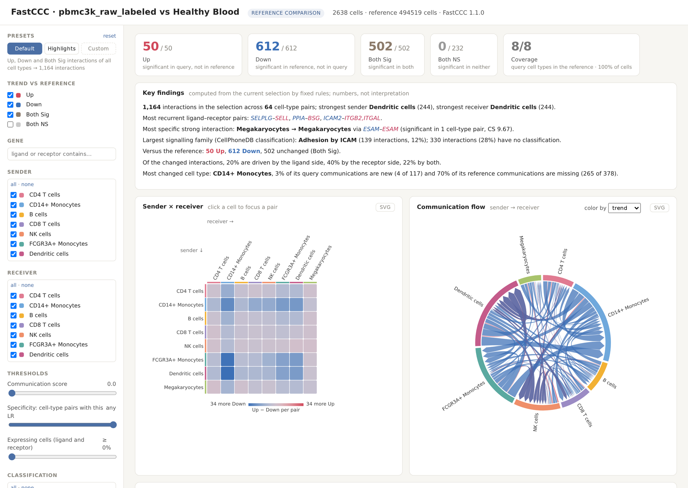
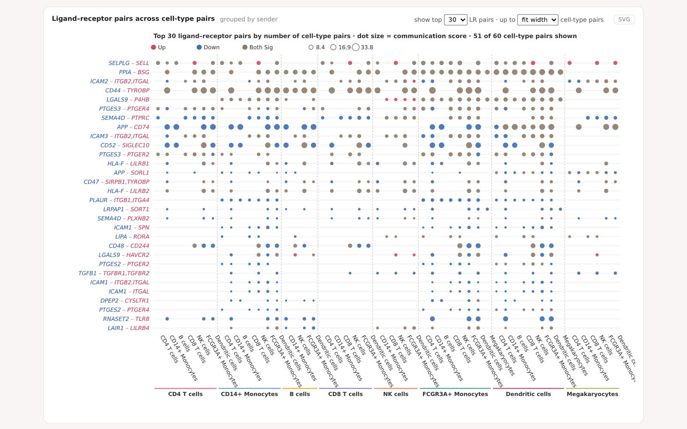
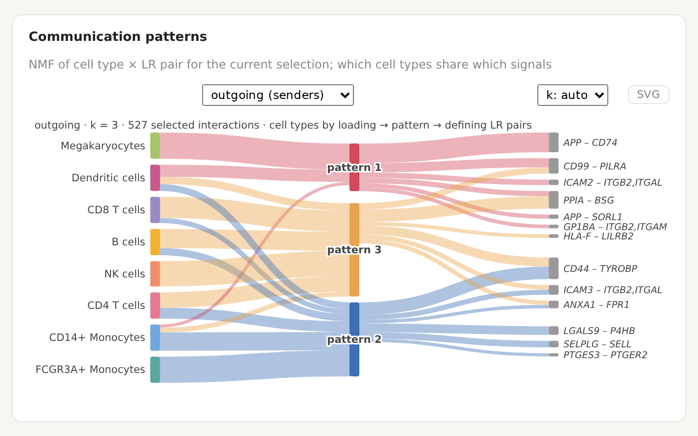
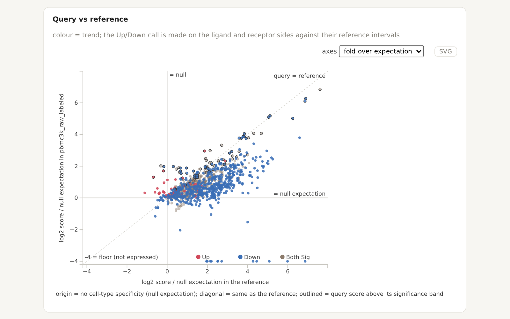
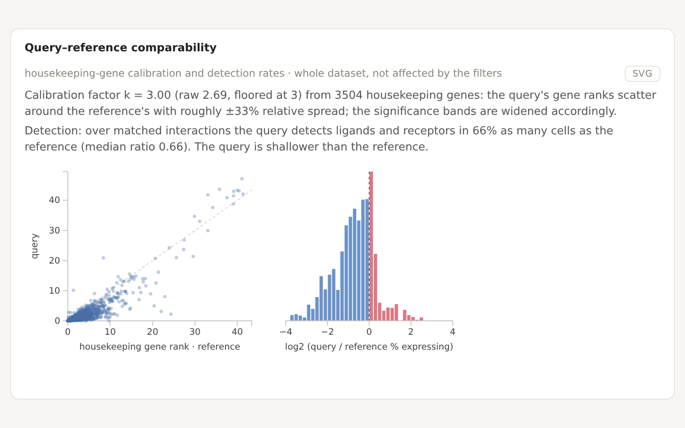
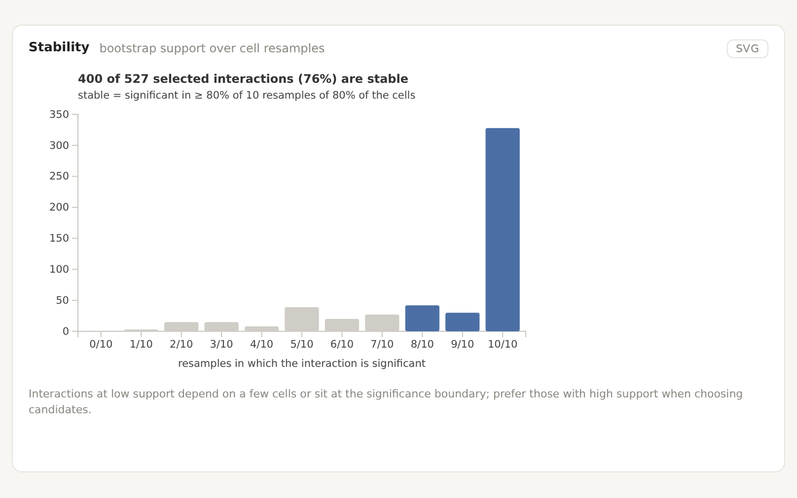
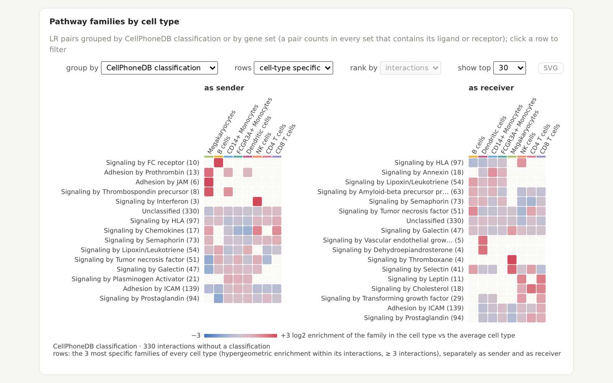
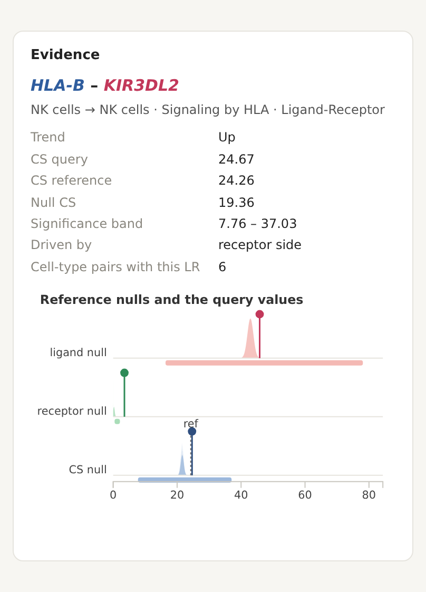
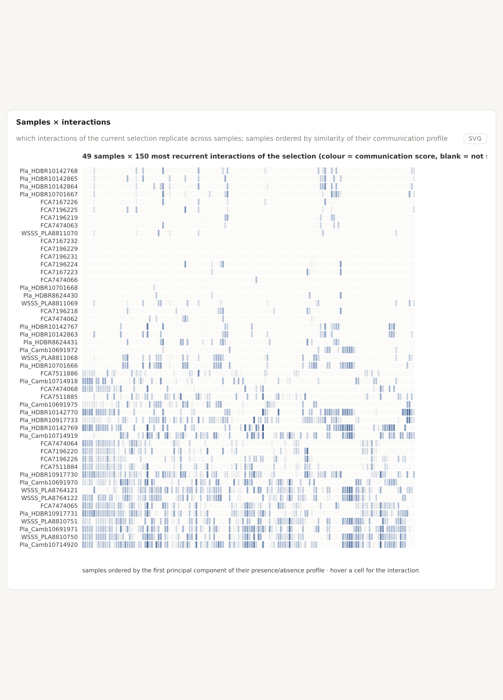

# FastCCC

**Cell–cell communication analysis for single-cell RNA-seq that tells you what is different from healthy tissue.**
FastCCC infers ligand–receptor signalling between cell types without permutations, so a million cells take minutes, and compares your dataset against built-in healthy tissue reference panels (19 tissues, 16 million cells) to report which communications are **Up** or **Down** versus normal. Every run ends in a self-contained interactive page with publication-ready figures.

[](https://doi.org/10.1038/s41467-025-66272-z) &nbsp;
[](https://svvord.github.io/FastCCC/) &nbsp;
[](https://pypi.org/project/fastccc/) &nbsp;
[](https://pypi.org/project/fastccc/) &nbsp;
[](https://github.com/Svvord/FastCCC/actions/workflows/ci.yml) &nbsp;
[](https://github.com/Svvord/FastCCC/blob/main/LICENSE)

## 60 seconds to a result

```bash
pip install fastccc                                   # Python 3.11-3.13; 22 ligand-receptor databases ship inside

fastccc inspect data.h5ad                             # what is in the file: matrix type, cell-type column, raw counts
fastccc run data.h5ad -c cell_type -o results/sample  # cell-cell communication of one dataset
fastccc ref data.h5ad -c cell_type -r liver --auto-map -o results/vs_liver
                                                      # ... compared against healthy liver: Up / Down per interaction
```

Each command writes its tables plus `explorer.html`: open it in any browser (no server, no internet needed).

<p align="center">
  
</p>

The same in Python:

```python
import fastccc

res = fastccc.run("data.h5ad", "cell_type", out_dir="results/sample")
res.summary()                     # cell types, significant interactions, top senders / receivers / LR pairs
res.significant.head()            # sender, receiver, ligand, receptor, p-value

q = fastccc.compare_to_reference("data.h5ad", "cell_type", reference="liver",
                                 celltype_mapping="auto", out_dir="results/vs_liver")
q.trend_counts                    # {'Up': ..., 'Down': ..., 'Both Sig': ..., 'Both NS': ...}
q.interaction_summary("Down")     # ligand-receptor pairs lost versus healthy liver, ranked
```

## What you get

<table>
<tr>
<td width="50%" valign="top"><br><b>Ligand–receptor pairs across cell-type pairs</b>, grouped by sender and coloured Up / Down / unchanged versus the reference.</td>
<td width="50%" valign="top"><br><b>Communication patterns.</b> Non-negative matrix factorisation of cell type × ligand–receptor pair: which cell types share which signals.</td>
</tr>
<tr>
<td valign="top"><br><b>Query vs reference.</b> Every interaction's fold over the null in the query and in the reference, coloured by trend.</td>
<td valign="top"><br><b>Is my data comparable to the reference?</b> Housekeeping-gene calibration and the detection-rate shift, with a plain-language reading.</td>
</tr>
<tr>
<td valign="top"><br><b>Which hits are solid?</b> Bootstrap support over cell resamples shows which interactions survive resampling the cells.</td>
<td valign="top"><br><b>Pathway families by cell type.</b> Enrichment of signalling families per cell type as sender and as receiver, clustered.</td>
</tr>
<tr>
<td valign="top"><br><b>Evidence for one interaction.</b> The reference-derived nulls of the ligand side, the receptor side and their combined score, the significance band, and where the query falls.</td>
<td valign="top"><br><b>Replication across samples.</b> Which interactions recur in which samples of a split run, samples ordered by their communication profile.</td>
</tr>
</table>

The explorer also has a filter panel with a dataset-adaptive *Highlights* preset (specific, well-supported, robust interactions), a sortable table with a shortlist and CSV export, signalling roles, sender → ligand–receptor → receiver flows, in-page pathway enrichment, per-cell violins and embedding overlays, effect sizes, a figure builder that composes panels into one lettered SVG, and a methods paragraph with the run's numbers ready to paste.

## Why FastCCC

| | FastCCC | CellPhoneDB | CellChat | LIANA+ |
|---|---|---|---|---|
| Null distribution | analytic (FFT convolution), exact p-values without permutations | permutation | permutation | per-method |
| Million-cell datasets | yes: the 1M-cell AIDA and 2M-cell HLCA atlases run to completion in the paper's benchmark | not completed in the benchmark | not completed in the benchmark | depends on the wrapped method |
| Scoring | 16 modules (4 expression summaries × 2 complex aggregations × 2 ligand–receptor combinations), combined with the Cauchy test; the modules also tell *broad* from *sub-population* signals | one score | one score | consensus of methods |
| Compare with healthy tissue | built-in reference panels for 19 tissues (16M cells); every interaction labelled Up / Down / unchanged, with a comparability check | – | – | – |
| Two conditions in your data | control group as reference: `fastccc ref data.h5ad -r condition:control:disease` | DEG-based method with differential genes you supply | comparative analysis across conditions | targeted differential analysis, MOFA+, Tensor-cell2cell |
| Robustness | bootstrap support over cell resamples; replication across samples; effect sizes | – | – | – |
| Output | interactive self-contained HTML + TSV tables + JSON manifest | tables | R objects and plots | tables |
| Ligand–receptor databases | 22 packaged: CellPhoneDB v4/v5, CellChatDB, NicheNet v1/v2, the LIANA+ consensus and its 15 sources, a mouse consensus; `fastccc db import` adds your own | CellPhoneDB | CellChatDB | OmniPath resources |
| Agent-ready | CLI with `--json`, run manifest, agent skill (`npx skills add Svvord/FastCCC`) | – | – | – |

Benchmark details, false-positive rates and F1 scores on ten datasets are in the paper (Fig. 3).

## Use FastCCC from your coding agent

FastCCC ships an agent skill that teaches Claude Code, Codex, Cursor and other coding agents how to run it from plain-language requests. Install it once:

```bash
npx skills add Svvord/FastCCC        # any supported agent, no Python needed
fastccc skill install                # or, after pip install fastccc: into .claude/skills and .agents/skills
```

Then ask your agent, for example:

```text
/fastccc Compare ./data/tumour.h5ad with the healthy liver reference panel. The cell type column is cell_type. Which cell-cell communications are up or down compared with normal liver?
```

```text
/fastccc Run cell-cell communication analysis on ./data/sample.h5ad (cell types in cell_type) and tell me which interactions are specific and robust.
```

```text
/fastccc In ./data/cohort.h5ad use condition == control as the reference and tell me which communications the disease cells gained or lost.
```

In Codex the prefix is `$fastccc`. The skill lives in [.claude/skills/fastccc](https://github.com/Svvord/FastCCC/tree/main/.claude/skills/fastccc) and inside the package (`fastccc skill show`).

## Inputs and outputs in one paragraph

Input is an `.h5ad` (AnnData) with a cell-type column in `obs` and gene symbols matching the database (HGNC for the human databases, MGI for the mouse one). Raw counts, normalised or log-normalised matrices are all accepted: `fastccc inspect` tells you what it found, the standard analysis normalises raw counts itself, and the reference comparison ranks genes within each cell so it does not care. Outputs go to the folder you name: `fastccc_run.json` (everything about the run), `*_significant_results.tsv` or `query_infer_results.tsv` (one row per sender, receiver and ligand–receptor pair, with p-values, scores and, for reference comparisons, the Up / Down trend and the reference values), and `explorer.html`. Everything is documented in the [output reference](https://svvord.github.io/FastCCC/reference/outputs.html).

## Reference panels

Nineteen healthy human tissues built from CELLxGENE Census data: adipose, blood, bone marrow, breast, cerebral cortex, colon, eye, heart, kidney, liver, lung, lymph node, midbrain, prostate gland, skin, small intestine, spleen, stomach and thymus. Panels download on first use (3–5 MB each) into `~/.fastccc/reference`. `fastccc panels --show liver` lists a panel's cell types; `fastccc map data.h5ad -c cell_type -r liver` proposes how your labels map onto them and tells you what it could not match. You can also build your own panel from any dataset or control group with `fastccc build-ref`. Details: [reference panels](https://svvord.github.io/FastCCC/reference/panels.html).

## Ligand–receptor databases

Twenty-two ship inside the package: CellPhoneDB v5 (default, with pathway families), CellPhoneDB v4, CellChatDB, NicheNet v1 and v2, the LIANA+ consensus and the 15 resources it is built from, and a mouse consensus. `fastccc db list --data data.h5ad` shows them with species, size and the fraction of their genes found in your data; `--db <name>` picks one. Your own pairs go in with one command and are then used by name:

```bash
fastccc db import pairs.csv --name mydb --species mouse --classification-col pathway
fastccc run mouse.h5ad -c cell_type --db mydb -o results/mouse
```

Sizes, citations and the import format: [databases](https://svvord.github.io/FastCCC/reference/databases.html).

## Installation

```bash
pip install fastccc            # PyPI, Python 3.11-3.13
# or
uv pip install fastccc
# or, for development
git clone https://github.com/Svvord/FastCCC.git && cd FastCCC
uv sync --group test && uv run pytest
```

Conda users: create an environment with Python 3.11 or newer first, then `pip install fastccc`. The ligand–receptor databases are inside the package; nothing else needs cloning.

## Documentation

The [documentation site](https://svvord.github.io/FastCCC/) has a quick start, guides for inputs, conditions and samples, reference comparison, databases and the result explorer, the command-line and Python API references, the output file reference, an explanation of the method, and an FAQ. Changes are listed in [CHANGELOG.md](https://github.com/Svvord/FastCCC/blob/main/CHANGELOG.md).

## How it works, briefly

For every sender cell type, receiver cell type and ligand–receptor pair, FastCCC summarises ligand expression in the sender and receptor expression in the receiver (mean, median, upper quantiles; complexes aggregated by minimum or average) and combines the two sides into a communication score. The distribution of that score under random cell-type labels is computed analytically instead of by permutation: means by FFT convolution, quantile summaries by the exact distribution of order statistics of a discrete variable (ties included, which the textbook formula gets wrong). This makes the p-values exact and the run time independent of the number of permutations; the machinery is usable on its own ([distribution toolkit](https://svvord.github.io/FastCCC/methods/distributions.html)). Sixteen such scoring modules are combined with the Cauchy combination test. For reference-based analysis, a panel stores per-gene expression distributions of a large healthy dataset; the query is rank-transformed within cells, calibrated to the panel on housekeeping genes, and every interaction is tested against the reference-derived null, giving Up, Down, Both Sig or Both NS. The paper has the full description: Hou, Ma & Zhou, *Nature Communications* 16, 11428 (2025).

## News

- **2026-11-14** v1.1.0: one-call API and CLI, automatic input inspection, cell-type mapping to reference panels, interactive result explorer, bootstrap support, effect sizes, replication across samples, 22 ligand–receptor databases including mouse (`fastccc db`), `--min-cells` for split runs, module selection flags, revised Cauchy combination, agent skill, CI and PyPI metadata. See [CHANGELOG.md](https://github.com/Svvord/FastCCC/blob/main/CHANGELOG.md).
- **2026-05-22** v1.0.1: bug fixes, coding-agent skills, improved automated reports and reference reports.
- **2025-02-01** Reference panels shrink from 3 GB to 5 MB per tissue; essential data is computed on first use.
- **2025-01-23** Tutorial site published.

## Citing FastCCC

If FastCCC is useful for your work, please cite:

> Hou, S., Ma, W. & Zhou, X. FastCCC: a permutation-free framework for scalable, robust, and reference-based cell-cell communication analysis in single cell transcriptomics studies. *Nat Commun* 16, 11428 (2025). https://doi.org/10.1038/s41467-025-66272-z

```bibtex
@article{hou_fastccc_2025,
  title   = {{FastCCC}: a permutation-free framework for scalable, robust, and reference-based cell-cell communication analysis in single cell transcriptomics studies},
  author  = {Hou, Siyu and Ma, Wenjing and Zhou, Xiang},
  journal = {Nature Communications},
  volume  = {16},
  year    = {2025},
  eid     = {11428},
  doi     = {10.1038/s41467-025-66272-z},
  url     = {https://www.nature.com/articles/s41467-025-66272-z}
}
```

FastCCC is released under the MIT license. Visit our [group website](https://xiangzhou.github.io/) for more statistical tools for genetics, genomics and transcriptomics data.
